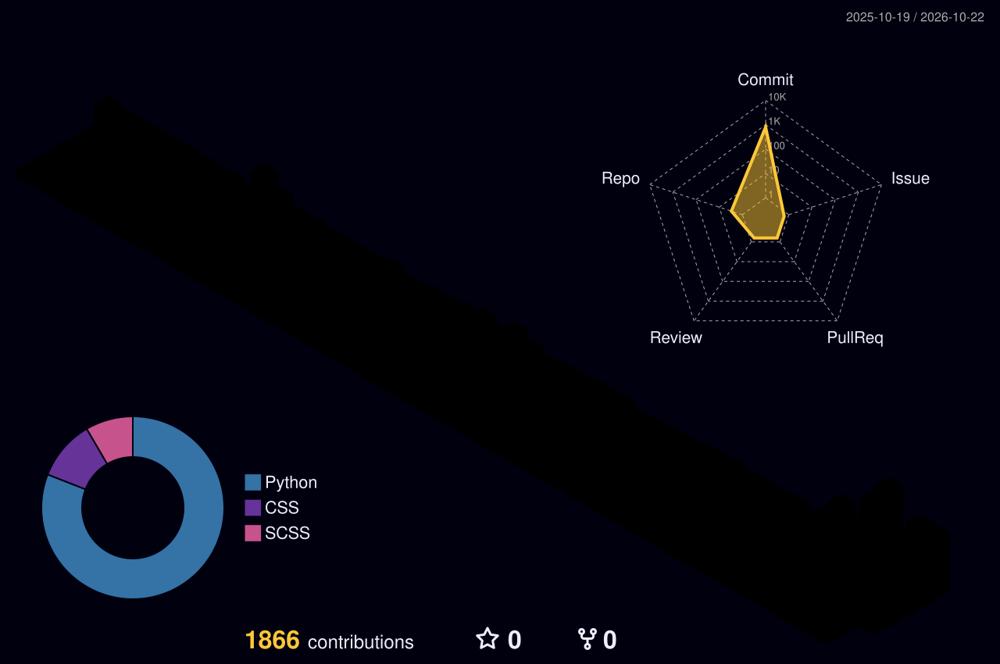

###  Nice ways to reach me

----
### Personal stats:

  
Highlights / Proficiencies

   

  <strong>Highlights</strong>  
  - ⭐ Studying cloud computing — <em>IaaS</em>, <em>PaaS</em> and <em>SaaS</em> — aiming to own the full path from server and database design through deployment.  
  - ⭐ Working toward automating my own day-to-day work with AI.  
  - ⭐ In graduate school, focused on research, papers and academic study.  
  - ⭐ Preparing to start my own business as a solo developer.  
  - ⭐ Still plenty to learn, but improving step by step — I post my studies and business progress every day on LinkedIn and my GitHub portfolio site.

   

  <strong>Proficiencies</strong>  
  - 📚 Languages: Java, C++, C#, C, Python  
  - 🌐 Web: HTML5, CSS3, SCSS  
  - 🗄️ Database: MySQL, Firebase  
  - 🔧 Collaboration & Etc.: Git, GitHub, GitHub Actions, Notion

----
### 💪 Skills

----
### 📊 GitHub

----
### 🌐 Web Site

| | |
|:--|:--|
| Study table | https://re8code.notion.site/Docs-Table-108d35d4aa4680bda4c5d19c8269498b |
| LWT Lab Site | https://loquacious-cheesecake-c77de1.netlify.app/ |
| Web 1-01 | https://github.com/Anyangta/web101 |
| Web 1-02 | https://github.com/Anyangta/web102 |
| Web 1-03 | https://github.com/Anyangta/web103 |
